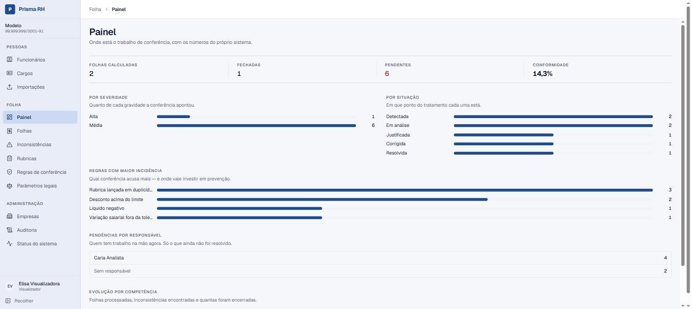
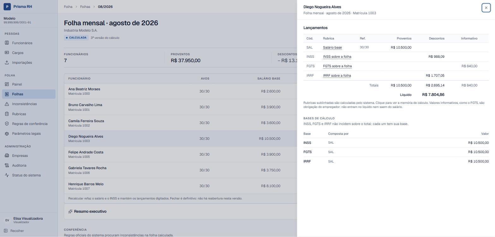
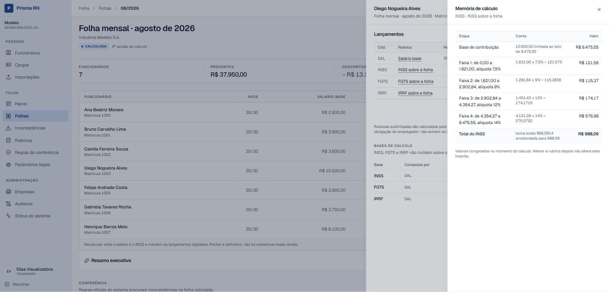
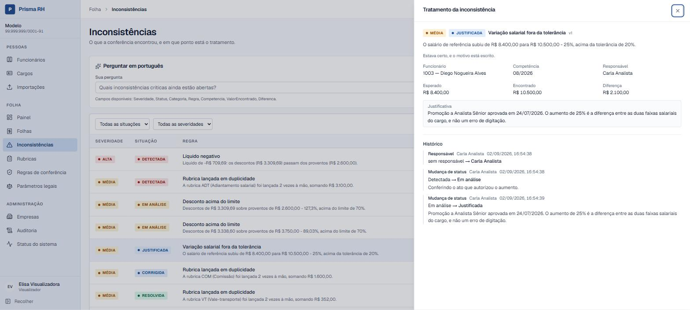
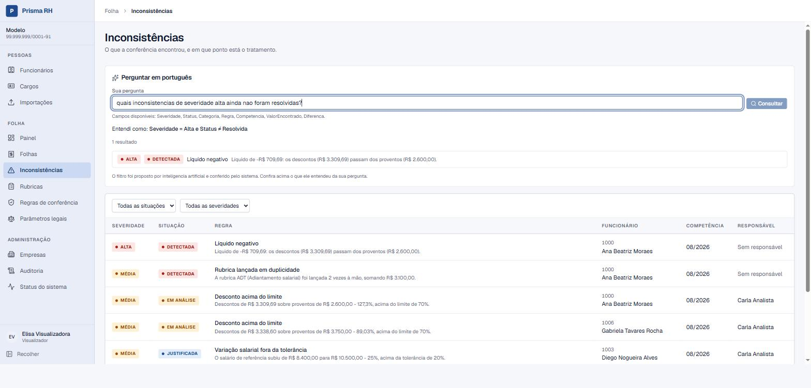
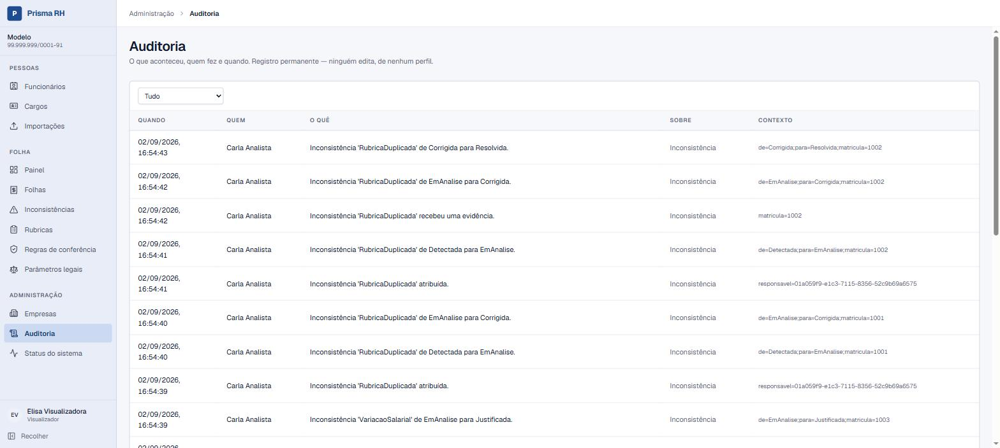

# Prisma RH

**Plataforma B2B de gestão, cálculo, conferência e auditoria de folha de pagamento
brasileira.** Multiempresa, com cálculo rastreável, motor de conferência automática e
trilha de auditoria.

🔗 **[Aplicação](https://portfolio-prisma-rh.vercel.app)** · React na Vercel, API em AWS
Lambda, banco no Neon PostgreSQL — **custo AWS previsto de US$ 0,00**.

https://github.com/user-attachments/assets/a0cf3b65-5684-4afe-97b0-11ea264c6f49

---

## O problema

Departamentos pessoais e empresas de BPO processam folha para muitas empresas, sob regras
que mudam com o tempo, e precisam **explicar cada valor** — às vezes anos depois, numa
reclamação trabalhista. O risco é financeiro e trabalhista ao mesmo tempo.

A maior parte das ferramentas produz um número. O Prisma RH produz o número **e a conta
que levou até ele**: quais rubricas entraram, sobre qual base, com qual parâmetro vigente,
em qual versão do cálculo.

## O que ele faz

| | |
|---|---|
| **Cadastro** | Organizações, empresas, estabelecimentos, funcionários, contratos e histórico contratual por vigência |
| **Folha** | Cinco tipos calculam: **mensal, férias, rescisão, adiantamento de 13º e 13º anual** — com memória de cálculo linha a linha |
| **Encargos** | INSS progressivo, FGTS, IRRF com dependentes, desconto simplificado e o redutor da Lei 15.270/2025 |
| **Importação** | CSV e XLSX, com preview, validação e relatório de erros — síncrona ou por fila |
| **Conferência** | Motor de análises com regras versionadas e tolerância parametrizável por organização |
| **Workflow** | Detectada → Em análise → Justificada → Corrigida → Resolvida, com responsável, comentários e evidências |
| **Auditoria** | Trilha somente-inserção: quem alterou, o quê, quando e de quanto para quanto |
| **IA** | Explica uma inconsistência, resume a folha e converte pergunta em português em filtro controlado |

## Como ele é

Entre com a conta pública de demonstração na
**[aplicação](https://portfolio-prisma-rh.vercel.app)** — somente leitura, dados
fictícios. O **Painel** abre com um roteiro de três minutos: folha → holerite → bases de
cálculo → memória de cálculo → inconsistências → auditoria. Tudo alcançável pelo teclado.

A folha do roteiro tem um holerite com **líquido negativo de propósito**: é o achado que a
conferência existe para pegar antes do fechamento, e o cálculo não foi ajustado para
escondê-lo.

|  |
|:--:|
| *O painel não mostra "quantas folhas rodaram". Mostra **onde está o trabalho**: o que cada regra acusou, em que ponto do tratamento cada achado está e quem tem pendência na mão.* |

|  |
|:--:|
| *INSS, FGTS e IRRF **não incidem sobre o mesmo número**. Cada base é apurada em separado e mostra quais lançamentos a compuseram — é a diferença entre um sistema que paga e um que consegue explicar por que pagou aquilo.* |

|  |
|:--:|
| *A imagem que resume o produto. O desconto de INSS não é um número: são cinco passos, cada um com a conta escrita, o teto aplicado e o arredondamento declarado. **Os valores ficam congelados** — mudar a rubrica amanhã não reescreve o holerite de hoje.* |

|  |
|:--:|
| *Nem toda divergência é erro. Um aumento de 25% acusa porque **merece confirmação**, e a justificativa fica no registro — com responsável, horário e o histórico de cada transição, que ninguém apaga.* |

|  |
|:--:|
| *A IA propõe; a aplicação decide. A pergunta vira `Severidade = Alta e Status ≠ Resolvida` — um filtro de **vocabulário fechado**, exibido na tela antes do resultado. O que estiver fora do vocabulário é recusado antes de virar consulta.* |

|  |
|:--:|
| *Tabela somente-inserção: não há endpoint de edição nem de exclusão, de nenhum perfil. Alteração de parâmetro legal, fechamento de folha e cada passo do workflow deixam rastro com autor, momento e o valor de antes.* |

## O que é tecnicamente interessante aqui

Se você veio olhar código, estes são os pontos que valem a leitura:

| Assunto | Onde | Em uma linha |
|---|---|---|
| **Isolamento multiempresa** | `PrismaRhDbContext` | Filtro global, não `where` escrito à mão. Sem usuário, `Guid.Empty` — que não casa com nada. Recurso de outro tenant devolve **404, não 403** |
| **Cálculo explicável** | `MotorCalculoFolha`, `LinhaMemoriaCalculo` | Cada holerite guarda os passos. Alterar a rubrica hoje **não** reescreve a folha de agosto |
| **Histórico que não é destruído** | `VigenciaContrato` | *Exclusion constraint* no PostgreSQL impede sobreposição de períodos mesmo sob requisições simultâneas |
| **Folha fechada sob concorrência** | `TravaFolha`, `FolhasEndpoints.AlterarFolhaAsync` | `SELECT ... FOR UPDATE` na linha da folha **antes** de lê-la: quem chega depois espera, encontra a folha já fechada e recebe 409. Provado com corrida determinística contra PostgreSQL real ([ADR 009](docs/adr/009-trava-pessimista-na-folha.md)) |
| **Defesa de SSRF** | `GuardaDestino` | Allowlist fixa em código, DNS resolvido e **todos** os IPs conferidos, `::ffff:` desembrulhado, redirect revalidado a cada salto |
| **Orçamento global com concorrência** | `OrcamentoBlobs` | `pg_advisory_xact_lock` para reservar espaço — funciona atrás do PgBouncer, onde lock de sessão não funciona |
| **CSRF com `SameSite=None`** | `GuardaCsrf` | *Double submit* comparado em tempo constante **mais** validação de `Origin`. Ausência é recusa |
| **Segredos fora das variáveis** | `SegredosSsm` | `get-function-configuration` devolve variável de ambiente em texto puro. A Lambda carrega o **nome** do parâmetro; o segredo vive no SSM `SecureString`, com `kms:Decrypt` restrito por `ViaService` |
| **IA que não calcula** | `VocabularioConsulta` | O modelo propõe campo, operador e valor; a aplicação confere contra lista fechada e monta `Where` tipado. **Não existe SQL vindo do modelo** |
| **Segurança testada, não afirmada** | `testes/Seguranca/` | Inventário de rotas lido da aplicação rodando, token forjado de seis formas, varredura de IDOR que inclui rotas futuras sozinha |

## Como está construído

```text
React + TypeScript (Vercel)
        │  fetch com access token em memoria
        ▼
ASP.NET Core Minimal APIs — monolito modular
        │
        ├── PrismaRH.Dominio        regras, sem EF, sem ASP.NET, sem AWS
        ├── PrismaRH.Aplicacao      casos de uso
        ├── PrismaRH.Infraestrutura EF Core, integracoes, IA
        └── PrismaRH.Api            HTTP, autorizacao, limites
        │
        ▼
PostgreSQL (Neon)         SQS ──▶ Lambda Worker (importacao pesada)
```

**Monólito modular, não microserviços** — um produto com um banco e um time não tem o
problema que microserviço resolve, e teria todos os que ele traz.

## Números

Medidos em 11/10/2026, no commit descrito em
[docs/evidencias-portfolio-95.md](docs/evidencias-portfolio-95.md).

| | |
|---|---|
| Testes backend | **1300**, incluindo integração contra PostgreSQL real via Testcontainers — e a suíte roda **duas vezes**, a segunda em modo *globalization-invariant*, que é como a Lambda executa |
| Testes frontend | **185** |
| Testes de segurança | **50** em suíte própria e permanente, mais **14** de concorrência na folha |
| Rotas | **85**, das quais **4 anônimas** — cada uma com motivo escrito e travada por teste |
| Custo AWS previsto | **US$ 0,00** |

## Índice

| Documento | Para quê |
|---|---|
| [docs/arquitetura.md](docs/arquitetura.md) | Camadas, dependências, produção e por que cada escolha |
| [docs/entrevista.md](docs/entrevista.md) | As perguntas difíceis, com a resposta e o arquivo |
| [docs/adr/](docs/adr/) | As decisões que sustentam o resto, cada uma com a alternativa recusada |
| [docs/imagens/](docs/imagens/) | O que capturar da demo, e o que **não** pode aparecer na imagem |
| [docs/backup-e-restore.md](docs/backup-e-restore.md) | O exercício de restauração **executado**, com RPO e RTO medidos |
| [docs/evidencias-portfolio-95.md](docs/evidencias-portfolio-95.md) | A última rodada de correções, com o teste de corrida, o audit e o bundle medidos |
| [docs/publicacao.md](docs/publicacao.md) | Como publicar API, worker e frontend, e como reverter cada passo |
| [docs/historico-de-entregas.md](docs/historico-de-entregas.md) | O registro detalhado de cada fase e a tabela de endpoints |
| [docs/seguranca/pentest-2026-09.md](docs/seguranca/pentest-2026-09.md) | O pentest de 02/09/2026 contra a produção: dez categorias atacadas, nenhuma vulnerabilidade, cada controle com requisição e resposta reais |
| [ROADMAP.md](ROADMAP.md) | As 13 fases, com o Security Gate executado de cada uma |
| [CLAUDE.md](CLAUDE.md) | As regras permanentes do projeto |

Neste arquivo, mais abaixo: **[stack](#stack)** · **[como rodar](#como-rodar)** ·
**[testes](#testes)** · **[segurança](#segurança--o-que-o-código-garante-hoje)** ·
**[limitações técnicas](#limitações-técnicas)**.

## Limitações declaradas

Um portfólio que só lista acertos não é evidência de nada. O que **não** funciona:

- **Não é homologado.** Nenhuma obrigação é transmitida a órgão público, e o produto não
  substitui um sistema comercial de folha.
- **Afastamentos não existem** — não há registro de ausência no domínio, e é por isso que
  a redução de férias por faltas (art. 130) não é aplicada.
- **Três dos oito motivos de rescisão ficam bloqueados** por falta de fonte oficial
  confiável. O sistema **diz isso** em vez de chutar.
- **O motor de cálculo carrega todos os contratos da empresa** para processar uma folha.
  Não é listagem exposta — é carga interna de uma ação autenticada —, mas uma empresa com
  dezenas de milhares de vínculos exigiria processar em lotes.
- **O restore foi testado uma vez, em 01/09/2026** — não é automatizado. Testado uma vez
  é melhor que nunca, e pior que periodicamente.
- A lista completa está no [ROADMAP](ROADMAP.md), no fim da **Fase 12** e nas seções
  **Pós-Roadmap** e **Correção final de segurança**.

## Dados

A demonstração usa **apenas dados fictícios**. Nenhum CPF, salário ou nome real.

> ⚠️ Os CNPJs da demonstração foram **conferidos contra a Receita** e voltaram "não
> encontrado". Dígito verificador válido não reserva faixa fictícia: os dois documentos
> "inventados" que o projeto usava antes pertenciam a empresas reais.

---

## Stack

| Camada | Tecnologia |
|---|---|
| Backend | C#, .NET 10, ASP.NET Core (Minimal APIs), Entity Framework Core, Npgsql |
| Banco | PostgreSQL 17 local; Neon PostgreSQL em produção |
| Autenticação | JWT de 15 min em memória + refresh token opaco em cookie `HttpOnly` |
| Frontend | React 19, TypeScript, Vite, React Router, Tailwind CSS v4, Radix |
| Testes | xUnit + Testcontainers (PostgreSQL real); Vitest + Testing Library |
| Produção | Vercel (frontend), AWS Lambda com Function URL (API e worker), SQS, SSM Parameter Store |

## Como rodar

**Pré-requisitos:** .NET SDK fixado em [`global.json`](global.json) (10.0.400 ou
superior na mesma faixa) · Node.js 22 · Docker Desktop com Compose v2 — usado pelo banco
local **e** pelos testes de integração.

```bash
cp .env.example .env          # POSTGRES_* e PRISMARH_SEED_SENHA
docker compose up -d          # PostgreSQL em localhost:5433 (5433 para não brigar com
                              # um PostgreSQL nativo na 5432); `down -v` APAGA o volume

cd backend
dotnet ef database update --project src/PrismaRH.Infraestrutura --startup-project src/PrismaRH.Api
dotnet run --project src/PrismaRH.Api        # http://localhost:5080

cd ../frontend
npm ci
npm run dev                                  # http://localhost:5173
```

- As migrations **não** rodam no startup, de propósito: aplicar esquema e executar a
  aplicação são credenciais diferentes (`CLAUDE.md §24.21`). O `/health` acusa migration
  pendente.
- Fora de Development a API **recusa iniciar** sem `Jwt__ChaveAssinatura` e a conexão do
  banco vindos do ambiente; o `appsettings.json` base não tem credencial nenhuma. A senha
  do PostgreSQL local e a chave JWT de desenvolvimento estão versionadas de propósito —
  servem só a um container efêmero em `localhost`.
- Em Development, com banco vazio e `PRISMARH_SEED_SENHA` definida, a semeadura cria duas
  organizações fictícias: `admin@`, `analista@`, `auditor@`, `visualizador@` e
  `plataforma@prisma.exemplo`, mais `admin@horizonte.exemplo` — esta existe para você
  **ver o isolamento**: nenhuma empresa da Prisma aparece para ela.
- O frontend aponta para `http://localhost:5080`; para mudar, copie
  `frontend/.env.example` para `frontend/.env` e ajuste `VITE_API_URL`.
- A interface segue um shell único — menu com contexto de empresa, trilha no topo,
  tabelas como componente principal e detalhe em painel lateral. A fonte de verdade
  visual é o [DESIGN.md](DESIGN.md), obrigatório para tela nova.

A tabela de endpoints está em [docs/historico-de-entregas.md](docs/historico-de-entregas.md#endpoints).

## Testes

```bash
cd backend
dotnet test                                                   # exige Docker rodando
DOTNET_SYSTEM_GLOBALIZATION_INVARIANT=1 dotnet test           # como a Lambda executa

cd ../frontend
npm run lint && npm run test && npm run build
npm audit --audit-level=high
```

- **Integração usa PostgreSQL real** (Testcontainers). Filtro global testado contra banco
  falso não prova nada: o EF InMemory nem gera SQL. Os testes de domínio e de contrato não
  dependem de banco — o do `/health` usa de propósito uma conexão inacessível, para provar
  que a API responde degradada sem vazar detalhe.
- **O modo invariante não é opcional.** Em 02/09/2026 o motor de cálculo devolvia 500 em
  produção enquanto a suíte inteira passava — a máquina tinha ICU e a Lambda não. O CI
  roda a suíte nos dois modos desde então.
- **Concorrência é testada com ordem escolhida, não sorteada:** `FolhaConcorrenciaTestes`
  estaciona uma requisição entre "li a folha" e "gravei", e espera por condição observada
  no PostgreSQL (`pg_stat_activity`), com prazo máximo.

## Segurança — o que o código garante hoje

Este projeto **não afirma ser "100% seguro"**. O que segue é o que existe no código, com
o arquivo, revisado em 11/10/2026. O modelo completo está em [`CLAUDE.md §24`](CLAUDE.md);
desde 27/08/2026 toda fase do roadmap passa por um **Security Gate** obrigatório, e a de
Hardening é auditoria final, não o começo da segurança.

| Garantia | Como | Onde |
|---|---|---|
| Isolamento entre organizações | `IdOrganizacao` só do token; filtro global no `DbContext`; sem usuário, `Guid.Empty`. Recurso alheio devolve **404, não 403** | `PrismaRhDbContext` |
| CPF | Mascarado na listagem (`111.***.**7-35`), inteiro só no detalhe. A busca exige o documento completo e válido — busca parcial viraria descoberta de CPF por tentativa | `FuncionariosEndpoints` |
| Rota nova nasce fechada | `FallbackPolicy` exige autenticação; 4 rotas anônimas, cada uma num inventário com motivo | `PoliticasAutorizacao`, `InventarioDeRotasTestes` |
| Força bruta no login | Limite **por IP**: 10/min em `entrar`, 60/min em `renovar` e `sair`. Mais **bloqueio progressivo por conta** (30 s dobrando até 15 min, que expira sozinho; um acerto zera), com resposta idêntica para e-mail inexistente, senha errada e conta em espera | `Program.cs`, `PoliticaBloqueioConta` |
| Custo e cota de terceiros | IA: 20 chamadas/hora **por organização**; consulta de CNPJ: 20/min por organização | `OrcamentoIa`, `IntegracoesEndpoints` |
| Sessão | Access token só em memória. Refresh opaco em cookie `HttpOnly`, `Secure` fora de Development, `SameSite=None` em produção (`Lax` em Development), `Path=/api/autenticacao`, guardado no banco como hash, com rotação e detecção de reúso | `AutenticacaoEndpoints` |
| CSRF com `SameSite=None` | *Double submit*: o cookie `prismarh_csrf` também é `HttpOnly`; o valor volta no corpo de `entrar`/`renovar`, a tela o guarda no `sessionStorage` e o repete em `X-CSRF-Token`; comparação em tempo constante **e** `Origin` em allowlist de hostname exato — origem ausente é recusa | `GuardaCsrf` |
| Listagens | Envelope paginado (padrão 50, teto 200) nas que crescem; teto rígido de 500 nos sub-recursos limitados por natureza; ordenação determinística | `Paginacao` |
| Folha fechada | Escrita na folha só sob trava de linha, numa transação que inclui a auditoria; 409 explicado na API e tela recarregada | `TravaFolha`, `FolhaDetalhe.tsx` |
| Entrada malformada | 400/413 sem eco do JSON recebido e sem stack trace | `TratamentoDeErro` |
| Segredos de produção | A Lambda carrega o **nome** do parâmetro; o valor vive no SSM `SecureString` | `SegredosSsm` |

**Sobre XSS, sem exagero.** O React escapa texto por padrão e o projeto não usa
`dangerouslySetInnerHTML`; a CSP da Vercel é estrita em `script-src`. Mas cookie
`HttpOnly` **não torna a sessão imune** a um XSS: o script injetado não consegue ler o
cookie, porém, enquanto a página estiver aberta, pode agir *como a página* — ler o que
ela guarda e chamar a API com a sessão do usuário. A defesa contra XSS é não ter XSS; o
cookie `HttpOnly` limita o que um XSS consegue levar embora para usar depois.

## Limitações técnicas

As do produto estão em [Limitações declaradas](#limitações-declaradas), acima. Do lado
técnico:

- **CNPJ alfanumérico** da Receita não é aceito: exige fonte oficial confirmada
  (`CLAUDE.md §29`). O ponto está isolado em `PrismaRH.Dominio/Empresas/Cnpj.cs`.
- **Sem WAF nem CDN na frente da API** — ambos têm custo fixo, e o requisito é US$ 0,00.
  O rate limit corta na aplicação, mas a invocação da Lambda já aconteceu.
- **`style-src 'unsafe-inline'`** na CSP do frontend, porque o Tailwind injeta estilo em
  runtime. `script-src` continua estrito.
- **Publicação manual**, por roteiro versionado ([docs/publicacao.md](docs/publicacao.md));
  o CI testa, mas não publica.
- As pendências de segurança, abertas e resolvidas, ficam datadas em `CLAUDE.md §24.19`.
